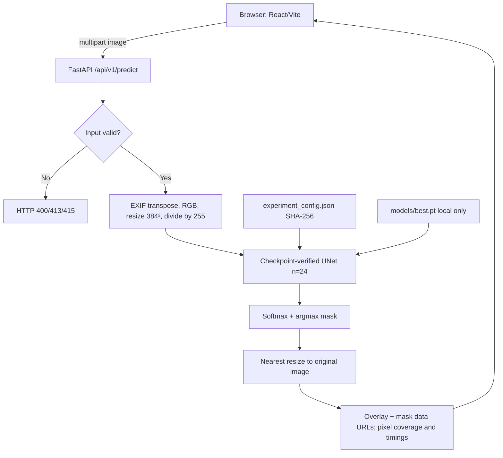
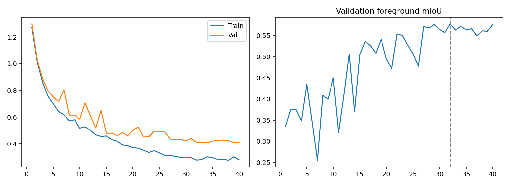
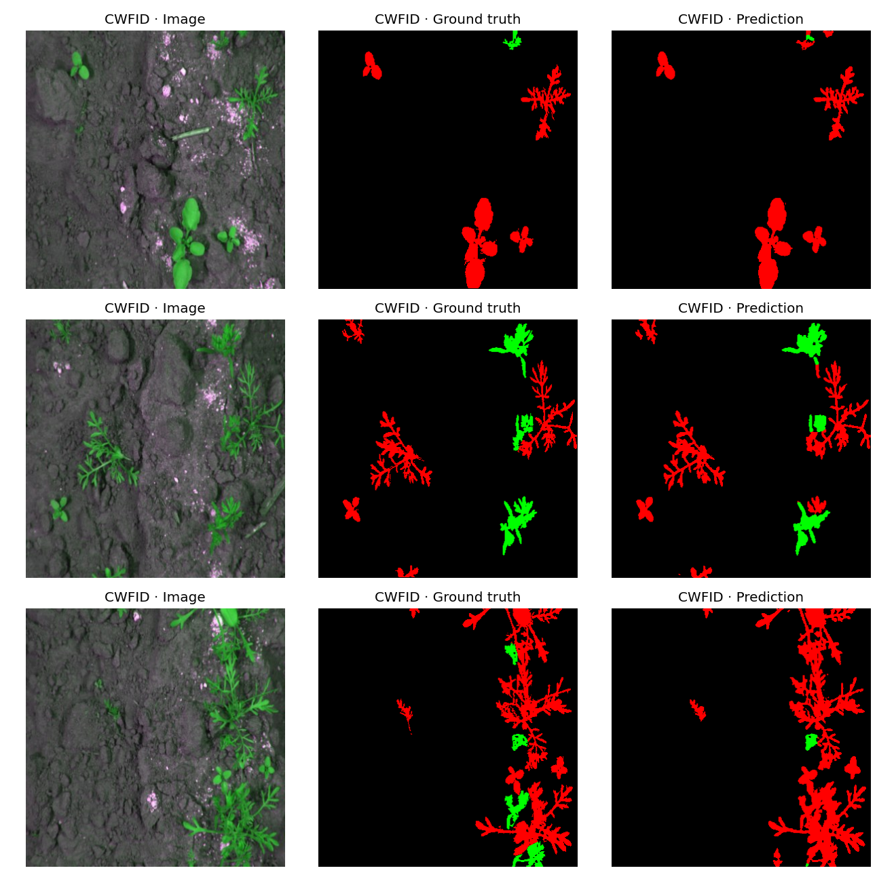
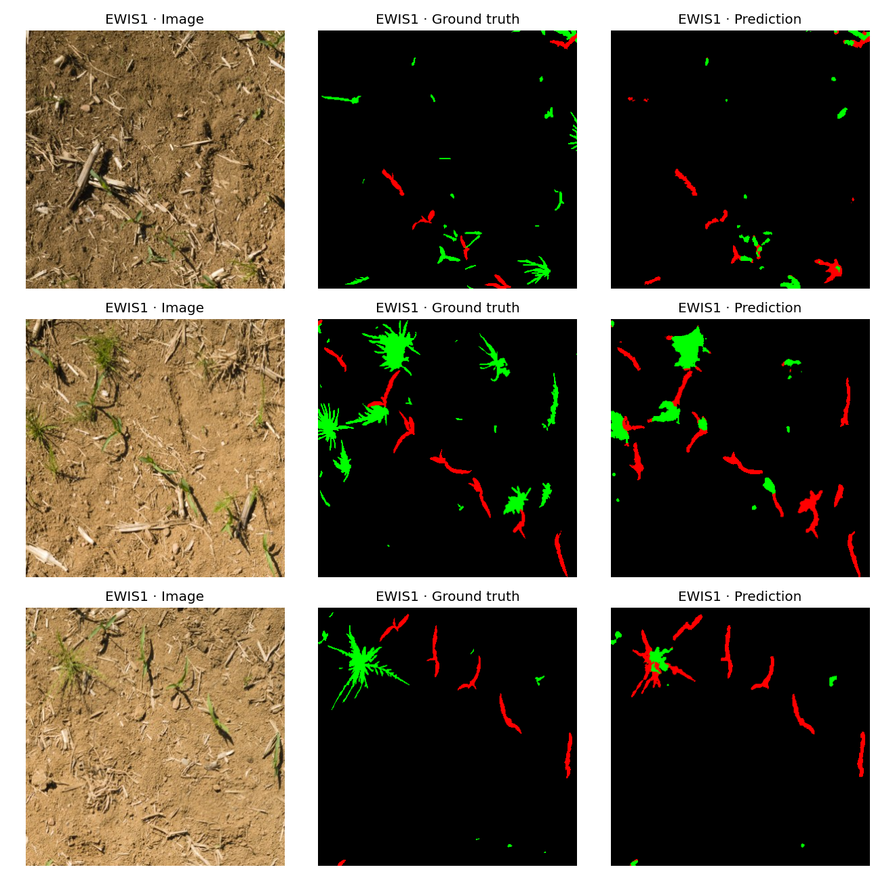
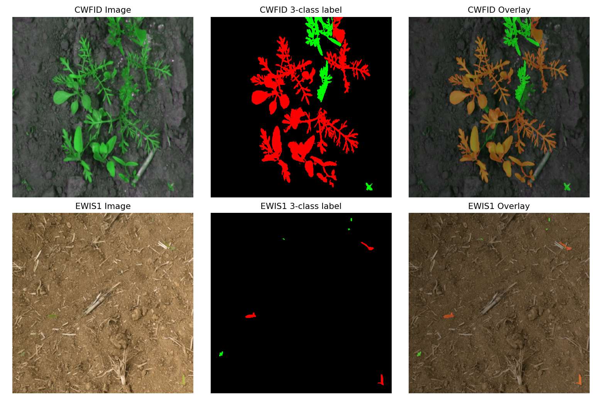

# WeedSpot — Day 35/100 🌱

**Pixel-wise crop and weed segmentation | Research prototype | PyTorch U-Net + FastAPI + React**

[English documentation](docs/en/README.md) · [Dokumentasi Bahasa Indonesia](docs/id/README.md) · [API](docs/en/architecture.md) · [Model card](docs/en/model_card.md) · [Reproducibility](docs/en/reproducibility.md)

> **Current state (13 Nov 2026):** training and held-out research evaluation are documented; a locally provisioned V3 checkpoint and working UI/API inference have been demonstrated in user-run screenshots and logs. The checkpoint itself is **not distributed by GitHub**, and independently reproducible field-site evaluation, deployment hardening, and complete automated E2E coverage remain outstanding.

## Executive summary

WeedSpot is a research-first precision-agriculture **semantic segmentation** prototype. It estimates which pixels in a field photograph correspond to **background (0), crop (1), or weed (2)**. This offers a visual screening aid for agronomy research, annotation exploration, and human field inspection. It does **not** identify species, guarantee biological weed identity, measure physical land area, or safely direct autonomous herbicide use.

It combines supervised **CWFID (60 paired originals)** and **EWIS1 (88 paired originals)**, applies source-specific mask decoding, a group-preserving split, compact scratch-trained `UNet(n=24)`, and a browser workflow for uploads, interactive overlays, masks, and predicted pixel composition. The selected epoch is **32**, with reported **validation foreground mIoU 0.5772**; held-out test results are reported separately by source rather than disguised as one combined accuracy.

## Problem, users and decisions

Weed competition can affect crop establishment, but manual field review does not scale well. Intended users are **researchers, agronomy students, annotators and prototype developers** exploring imagery, comparing crop/weed patterns and inspecting failure cases. The application supports a **human-reviewed screening** workflow, not agronomic prescriptions. Research questions: (1) can one compact model learn crop-versus-weed pixels across two image domains? (2) how much does test IoU vary by source? (3) can a model checkpoint be safely verified and served through a lightweight local web app?

**In scope:** three-class semantic masks, visualization, local REST inference, source-separated evaluation, documented provenance and caveats. **Out of scope:** species taxonomy, object instance counts, georeferenced weed area, calibrated probability, irrigation advice, robotic treatment and commercial readiness.

## Before → Now → Next

| Stage | Evidence-based state |
|---|---|
| Before | V3 notebook, dataset/mask audit, session-aware splitting, training history, test confusion matrices and recorded checkpoint hash |
| Now | FastAPI endpoints, checksum-checked checkpoint loader, React segmentation studio, sample-image inference shown locally; three backend contract tests and production frontend build pass in user logs |
| Next | Document exact checkpoint retrieval, run quantitative local parity and end-to-end tests, review novel field imagery, test input robustness, verify privacy/security, and assess commercial license compatibility |

## Implemented features and maturity

| Feature | Status / boundary |
|---|---|
| Custom U-Net semantic inference | Implemented in backend; requires correct local `models/best.pt` |
| Model SHA-256 / architecture / class contract | Implemented, enforced at startup |
| Health, readiness and image API | Implemented; three narrow automated tests |
| Upload validation | JPEG/PNG/WebP, 10 MiB, 16 megapixels; MIME and decode checks |
| React image studio | Implemented: select/drop, analyze, compare slider, original/overlay/mask, coverage display and PNG visualization downloads |
| Recorded V3 training/test evaluation | Available as JSON/CSV; not independently rerun on this machine |
| Calibrated prediction confidence | Not evaluated |
| Public deployment and independent field-site assessment | Not yet validated |

## System architecture



The Vite development server proxies `/api` to `127.0.0.1:8000`; the backend only allows the local Vite origins in its CORS configuration. The backend starts model loading during application lifespan. `GET /health` is not equivalent to `GET /ready`.

## Datasets, provenance and labels

| Source | Original pairs | Annotations | Rights and constraints |
|---|---:|---|---|
| [CWFID](https://github.com/cwfid/dataset) | 60 | RGB image and 3-color segmentation mask: background `(0,0,0)`, crop `(255,0,0)`, weed `(0,255,0)` | Reported **noncommercial research** restriction; check original terms before redistribution/use |
| [EWIS1](https://data.mendeley.com/datasets/6j5pxgf437/1) | 88 | RGBA: transparent background; crop blue `(31,119,180)`; weed orange `(255,127,14)` | License **not recorded in supplied provenance JSON**; check publisher before redistribution/commercial use |

Kaggle training input recorded as `/kaggle/input/datasets/wafabila/weedspot-dataset` (a working path, **not a third independent dataset**). Mask palette decoding and class assignments were audited: `reports/mask_audit.json` reports no unknown class pixels in its audit. Never commit raw source data; datasets are stored separately.

## Preparation, split and leakage controls

| Source | Train originals | Validation originals | Test originals | Total originals |
|---|---:|---:|---:|---:|
| CWFID | 40 | 10 | 10 | 60 |
| EWIS1 | 60 | 14 | 14 | 88 |
| Total | 100 | 24 | 24 | 148 |

Each EWIS1 original produces **12 tiles (4 columns × 3 rows)**, giving 1,056 EWIS1 tiles, **1,116 total image samples after tiling** including 60 CWFID images. Tiles inherit their parent image's partition; they are not statistically independent field observations. CWFID blocks use a filename heuristic, EWIS1 groups by location-and-date session; a single site may still occur on different dates. Reported cross-split exact SHA-256 conflicts: **0**. This does **not** prove no near-duplicates or field-site independence.

The notebook decodes source-specific mask colors, crops EWIS1 into 4×3 tiles, resizes each tile/image to 384×384 (bilinear RGB; nearest-neighbor masks), normalizes input to `[0,1]`, and applies training-only flips, rotations, and brightness augmentation. Rare weed content influences sampling and loss; unknown-mask pixels are ignored. Exact duplicate SHA-256 groups are checked before split. This excludes certain byte-identical leaks but not near-duplicates or same-site revisits.

## Model and training

A scratch compact 3-level U-Net has convolution + batch normalization + ReLU blocks, max pooling, bilinear upsampling, skips, and a three-channel classification head. `n=24` base width, image size 384, batch size 4, seed 42, maximum 40 epochs, AdamW (`weight_decay=1e-4`), cosine scheduling, weighted cross entropy plus foreground Dice. **Champion selection used validation foreground (Crop + Weed) macro IoU only**; best epoch 32, validation score 0.5772258034. See `notebooks/weedspot.ipynb` for the executable training implementation, hyperparameters and runtime limits; the notebook's legacy comment mentioning 3×2 tiling is outdated—the actual `nx,ny=(4,3)` execution is the authority.

## Validation and held-out test results

| Source / split | Originals | Tiles | Background IoU | Crop IoU | Weed IoU | Foreground mIoU | Pixel accuracy |
|---|---:|---:|---:|---:|---:|---:|---:|
| CWFID validation | 10 | 10 | 0.9913 | 0.7924 | 0.6149 | 0.7036 | 0.9884 |
| EWIS1 validation | 14 | 168 | 0.9918 | 0.7050 | 0.4201 | 0.5626 | 0.9903 |
| CWFID test | 10 | 10 | 0.9901 | 0.7452 | 0.3410 | 0.5431 | 0.9834 |
| EWIS1 test | 14 | 168 | 0.9872 | 0.6477 | 0.3985 | 0.5231 | 0.9842 |

**Interpretation:** Weed is substantially harder than crop. CWFID test Weed IoU is **0.3410** versus EWIS1 **0.3985**, despite high pixel accuracy due to dominant background pixels. Test sets contain only 10 CWFID and 14 EWIS1 original images, so confidence intervals are broad. The reported 95% parent-bootstrap foreground mIoU CIs are **[0.4246, 0.6591]** CWFID and **[0.4784, 0.5693]** EWIS1, each based on 400 parent resamples. Neither source has demonstrated independent new-field generalization. See raw confusion CSVs, source-separated evaluation and bootstrap JSON.

## Visual experimental evidence


*Recorded training and validation curves from the V3 notebook; inspect raw values in `reports/training_history.csv`.*


*Research examples from the held-out CWFID group; qualitative examples are not a substitute for metrics.*


*EWIS1 test predictions; remember that twelve tiles can originate from one source image.*


*Source-specific color mapping audit: CWFID and EWIS1 use distinct annotation palettes.*

An app screenshot has been viewed during development but **is not currently checked into `assets/screenshots/` on GitHub**. Add an actual saved screenshot there only after review; no fake placeholder is shown.

## Run locally (Windows / PowerShell 5.1)

```powershell
cd 'D:\porto\100 day\day 35'
$Python = 'C:\DevEnvs\ai-general\Scripts\python.exe'
& $Python -m pip install -r backend\requirements.txt
cd frontend
npm ci
npm run build
cd ..
# Terminal 1 (stays running)
.\scripts\run_backend.ps1
# Terminal 2 (new PowerShell tab, from repo root)
.\scripts\run_frontend.ps1
```
Open `http://127.0.0.1:5173`; API schema at `http://127.0.0.1:8000/docs`. Both run scripts assume the **Windows-only shared Python path** above, so other installations must edit `scripts/run_backend.ps1` or run `python -m uvicorn app.main:app` from `backend/` with their own interpreter. `best.pt` must be provisioned separately at `models/best.pt`; it is intentionally ignored by Git.

## API contract and end-to-end smoke test

| Method / route | Contract | Failure / notes |
|---|---|---|
| `GET /api/v1/health` | `{"status":"ok","service":"weedspot-api"}` | Reachability only; not model health |
| `GET /api/v1/ready` | `model_ready`, `model_name`, `device`, `image_size`, `classes`, `checkpoint_sha256_matches`, `detail` | May return HTTP 200 with `model_ready=false` |
| `POST /api/v1/predict` | `multipart/form-data` field `file` (PNG/JPEG/WebP); JSON including `width`, `height`, `class_percentages`, `average_pixel_confidence`, `processing_ms`, `overlay`, `mask`, `palette`, `warning` | 400 invalid/empty, 413 >10 MiB or >16 MP, 415 unsupported MIME, 503 model unavailable, 500 failed inference |

Overlay and mask are **base64 data URLs**. `class_percentages` sum approximately 100% after per-class rounding and refer to the **resized predicted pixel grid returned to original image dimensions**, not calibrated acreage. `average_pixel_confidence` is the mean maximum softmax probability **before upscaling**, not an empirically calibrated correctness probability. `processing_ms` includes preprocessing, model execution and output encoding, not necessarily network transfer.

```powershell
$Python = 'C:\DevEnvs\ai-general\Scripts\python.exe'
cd 'D:\porto\100 day\day 35\backend'
& $Python -m pytest -q
Invoke-RestMethod http://127.0.0.1:8000/api/v1/ready | ConvertTo-Json -Depth 5
# From a new terminal:
cd 'D:\porto\100 day\day 35\frontend'
npm run build
```
Expected `ready.model_ready=true` and `checkpoint_sha256_matches=true` only after the correct local checkpoint is loaded. The three tracked API tests check health, readiness contract, and rejection of invalid media type; **they do not test image segmentation quality or complete frontend-to-backend E2E**.

In the browser, choose a supported agricultural photograph, press Analyze, inspect the comparison slider and mask, then export a visualization. A local CWFID image `001_image.png` has produced a rendered result in a user screenshot; **this is proof of functioning inference plumbing, not ground-truth accuracy**. Do not use arbitrarily chosen examples to estimate test-set metrics.

## Reproducibility and model integrity

The expected `models/best.pt` SHA-256 is **`6380680aa33892dcdbe8b531d3642dca17434f2436717673fa6773fa07c22e7a`**. The loader requires a dictionary with `model` state dict, `architecture='UNet(n=24)'`, the ordered class labels and `image_size=384`. A missing/mismatched checkpoint yields `model_ready=false`, and prediction is blocked with HTTP 503. Verify locally with `Get-FileHash .\models\best.pt -Algorithm SHA256`. The GitHub repository's `.gitignore` excludes `*.pt`; reproduce or obtain the checkpoint from the approved research artifact source. **Do not silently substitute weights.** See [reproducibility](docs/en/reproducibility.md).

## Deployment, security and privacy

This is **local-development software**, not hardened for internet exposure. The API limits decoded image pixel count and upload bytes and does not intentionally persist uploaded image payloads, yet server logs, upstream proxy behavior and browser object URLs need a full privacy review before public deployment. Missing controls include authentication, rate limits, comprehensive automated input fuzzing, production monitoring, and deployment-specific HTTPS/CORS policy. `frontend/dist/` is build output, not a deployed public website.

## Repository map

```text
README.md; AGENTS.md; LICENSE; .env.example; .gitignore
notebooks/weedspot.ipynb           - Kaggle V3 experiment
models/                           - local best.pt (not committed)
reports/                          - audited JSON/CSV research evidence
assets/plots/                     - training_results.png
assets/examples/                  - label audit and per-source test examples
assets/screenshots/               - no committed application screenshot at audit
backend/app/main.py               - REST API and request validation
backend/app/model.py              - U-Net inference and checkpoint validation
backend/tests/test_api.py          - three API contract tests
frontend/src/App.tsx              - React studio and client-side state
frontend/src/style.css            - UI presentation
frontend/vite.config.ts           - API development proxy
scripts/run_backend.ps1           - local Python/Uvicorn launcher
scripts/run_frontend.ps1          - Vite launcher
docs/en/ and docs/id/              - bilingual engineering and research docs
```

## Known limitations, claim boundaries, roadmap

- **P0:** checkpoint provenance and local hash verification; image-level inference reproducibility and failure-case validation; missing external field-site generalization.
- **P1:** true end-to-end automated tests, corrupted-image stress tests, performance profiling and high-resolution tiling for inference (the current API resizes a **whole input image** to 384×384 and does **not** reproduce training-time EWIS1 4×3 tiling).
- **P2:** explicit permissions/license review for both sources, network authentication and production hosting plan, responsive/accessibility review, calibration work.

A real uploaded-image overlay **does not prove** agronomic correctness. The model yields **semantic pixel labels**, not boxes or individual weed instances. The app presents **percentages of predicted pixels**, not cultivated hectares. Recorded test results should not be presented as fresh blind field trials.

## Quick troubleshooting

| Symptom | Check |
|---|---|
| `Model unavailable` | Open `/api/v1/ready`; verify presence and SHA-256 of `models/best.pt` |
| API 503 | Check checkpoint class/architecture/resolution contract and backend logs |
| API 415 / 413 | Use JPEG/PNG/WebP under 10 MiB and 16 MP |
| Frontend cannot reach API | Run backend on port 8000; Vite proxy targets `127.0.0.1:8000` |
| Poor tiny-weed predictions | Current whole-image 384 resize, domain shift and training tile-resolution mismatch |
| High pixel accuracy but weak weed | Prefer foreground per-class IoU, confusion matrices, and real field review |

**FAQ:** Does it count individual weeds? **No.** Can it spray herbicides automatically? **No.** Is confidence calibrated? **Not tested.** Is the model included in GitHub? **No, `.pt` is ignored.** Is the code MIT-licensed? **Yes, according to `LICENSE`; that does not override third-party dataset restrictions.**

## License, attribution and references

Code is under [MIT LICENSE](LICENSE), copyright 2026. Dataset rights are **independent**; particularly, CWFID is research noncommercial. Cite [CWFID](https://github.com/cwfid/dataset) and [EWIS1](https://data.mendeley.com/datasets/6j5pxgf437/1) when using underlying material. See [full documentation index](docs/README.md), [model card](docs/en/model_card.md), [evaluation](docs/en/evaluation.md), and [troubleshooting](docs/en/troubleshooting.md). Developed by [MENSTRUE](https://github.com/MENSTRUE) for 100 Days of Projects.
