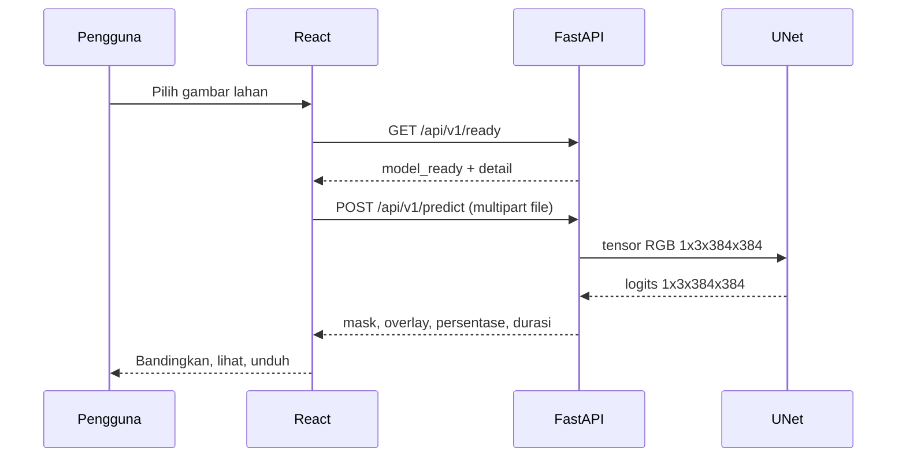

# Arsitektur sistem dan kontrak API

> WeedSpot Day 35 V3 | Evidence reviewed 2026-11-13. [Index](README.md) | [Root](../../README.md)

**Frontend:** React 19, TypeScript, proxy Vite `/api → http://127.0.0.1:8000`. `src/App.tsx` menyimpan state file, drag/drop, `fetch('/api/v1/ready')`, FormData POST, slider pembanding, tab overlay/mask/original dan unduh data URL. Tidak ada routing framework atau penyimpanan akun pengguna di server.

**Backend:** `backend/app/main.py` memakai FastAPI app versi 1.0.0, memuat `Predictor` saat lifespan, CORS hanya untuk `localhost:5173` dan `127.0.0.1:5173`, validasi 10 MiB/16 MP serta tipe MIME, lalu EXIF transpose dan RGB. `backend/app/model.py` memeriksa hash dan metadata checkpoint lokal, memakai PyTorch `UNet(n=24)` (CUDA jika tersedia, jika tidak CPU), softmax/argmax, nearest-neighbor untuk mask ke resolusi awal, lalu mengembalikan mask/overlay PNG base64.

| Method / route | Contract | Failure / notes |
|---|---|---|
| `GET /api/v1/health` | `{"status":"ok","service":"weedspot-api"}` | Reachability only; not model health |
| `GET /api/v1/ready` | `model_ready`, `model_name`, `device`, `image_size`, `classes`, `checkpoint_sha256_matches`, `detail` | May return HTTP 200 with `model_ready=false` |
| `POST /api/v1/predict` | `multipart/form-data` field `file` (PNG/JPEG/WebP); JSON including `width`, `height`, `class_percentages`, `average_pixel_confidence`, `processing_ms`, `overlay`, `mask`, `palette`, `warning` | 400 invalid/empty, 413 >10 MiB or >16 MP, 415 unsupported MIME, 503 model unavailable, 500 failed inference |

Overlay and mask are **base64 data URLs**. `class_percentages` sum approximately 100% after per-class rounding and refer to the **resized predicted pixel grid returned to original image dimensions**, not calibrated acreage. `average_pixel_confidence` is the mean maximum softmax probability **before upscaling**, not an empirically calibrated correctness probability. `processing_ms` includes preprocessing, model execution and output encoding, not necessarily network transfer.

**Contoh:** `curl.exe -F "file=@D:\images\field.png" http://127.0.0.1:8000/api/v1/predict` di Windows; simpan JSON ke file karena respons base64 besar. **Tidak ada endpoint penyimpanan upload.** CORS bukan autentikasi; jangan membuka server development ke internet tanpa keamanan tambahan.

---

**Evidence:** [`experiment_config.json`](../../reports/experiment_config.json), [`evaluation_by_source.json`](../../reports/evaluation_by_source.json), [`dataset_provenance.json`](../../reports/dataset_provenance.json), [`notebook`](../../notebooks/weedspot.ipynb).
